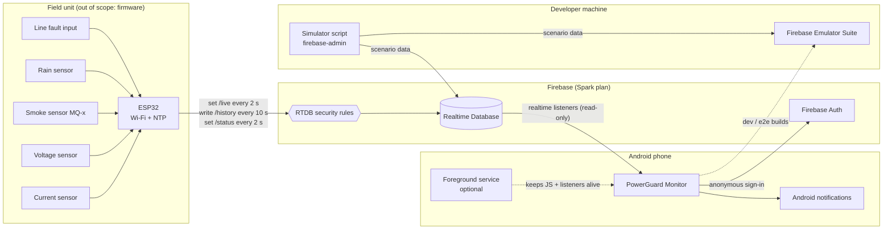
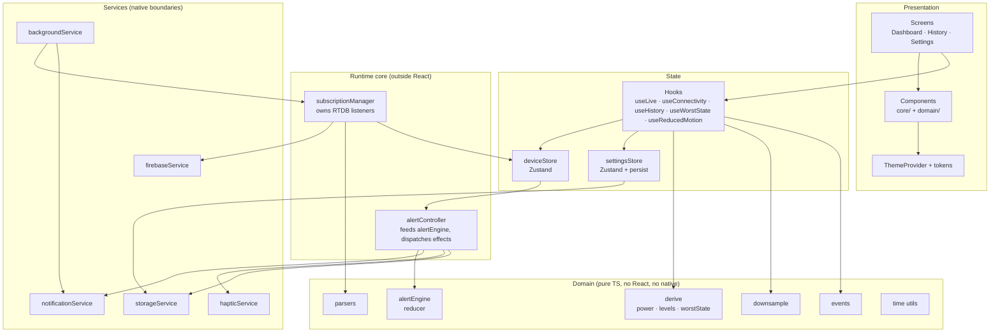
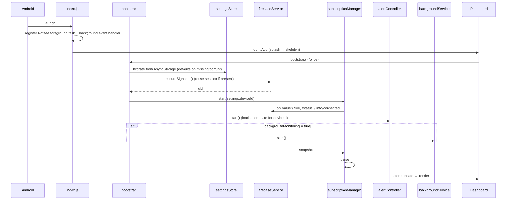
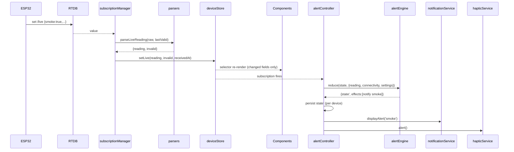
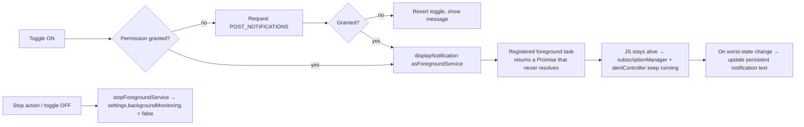
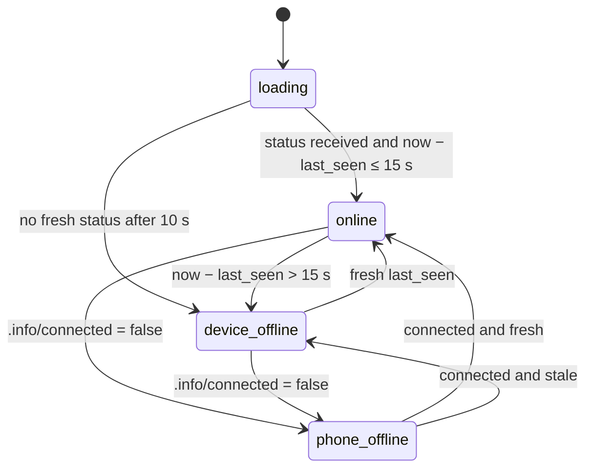

# Architecture

## Overview

PowerGuard Monitor is a **read-only, realtime client**. An ESP32 field unit writes small JSON snapshots to Firebase Realtime Database (RTDB). The Android app, built with React Native CLI, signs in anonymously, subscribes to those paths, validates every snapshot, and renders a live dashboard. It also runs a pure-TypeScript alert engine that turns state changes into local notifications.

Four forces shape the design:

1. **Correct alerts matter more than anything else.** Alert logic lives in one pure, fully tested module that runs outside React, so the UI and the background service can never disagree or send duplicates.
2. **The device firmware is untrusted input.** All RTDB data passes through one parser that never throws.
3. **Live updates arrive every 2 s on low-end phones.** State is held in selector-based stores so each update re-renders only what changed, and animations run on the UI thread.
4. **No paid Firebase features.** There is no server code, so everything happens on the client and alerts are best-effort ([ADR-0005](decisions/0005-local-notifications-foreground-service.md)).

## System context



**Trust boundaries:**
- The ESP32 is the only production writer. It authenticates as a dedicated Firebase user whose uid is whitelisted in the rules ([06-security.md](06-security.md#rtdb-rules)).
- The app is an authenticated reader and **cannot** write to `/devices/**`.
- The simulator uses the Admin SDK and bypasses rules. It is a developer tool only and is never shipped.

## Constants

These are the only source of these values. They are implemented in `src/domain/constants.ts`, and code must import them rather than repeat the numbers.

| Name | Value | Meaning |
|---|---|---|
| `LIVE_INTERVAL_S` | 2 | Expected ESP32 `/live` and `/status` write cadence |
| `HISTORY_INTERVAL_S` | 10 | Expected ESP32 `/history` write cadence |
| `OFFLINE_THRESHOLD_S` | 15 | `now − last_seen` above this → `device_offline` |
| `LOADING_TIMEOUT_S` | 10 | No status after this → `device_offline` |
| `CONNECTIVITY_TICK_MS` | 1000 | Staleness re-evaluation interval |
| `ALERT_CONFIRM_SAMPLES` | 2 | Consecutive `true` samples needed before notifying |
| `VOLTAGE_WARNING_MARGIN` | 0.05 | Warning band = within 5% of a voltage limit |
| `CURRENT_WARNING_RATIO` | 0.85 | Warning when current > 85% of `currentMax` |
| `CHART_RANGES` | `5m: 300 s / ≤30 pts`, `1h: 3600 s / ≤120 pts`, `24h: 86400 s / ≤150 pts` | Chart windows and point caps |
| `HISTORY_EVENTS_WINDOW_S` | 86400 | History screen window |
| `MS_TIMESTAMP_THRESHOLD` | 1e12 | Timestamps above this are milliseconds |

## Layered architecture



### Layer rules

1. **Screens and components never import services or `@react-native-firebase`.** They read state through hooks.
2. **The domain layer imports nothing from React, React Native, or any native module.** It must run under plain Jest in Node.
3. **The runtime core is a set of module-level singletons**, started once in `bootstrap()`. They run whether or not any screen is mounted, which is what lets the foreground service keep working while the UI is gone.
4. **Services are thin.** Each wraps one native library and exposes a small typed interface ([04-api-spec.md → Internal interfaces](04-api-spec.md#internal-module-interfaces)) so it can be mocked in tests.
5. **Data flows one way:** RTDB → firebaseService → parsers → deviceStore → (hooks → UI) and (alertController → effects). Nothing flows back to RTDB.

## Components

| Component | Responsibility | Inputs → outputs | Depends on | Location |
|---|---|---|---|---|
| `bootstrap` | Starts the app runtime once: hydrate settings, sign in, start subscriptions and the alert controller, start the background service if enabled | `()` → `Promise<void>` | all core + services | `src/core/bootstrap.ts` |
| `firebaseService` | Anonymous sign-in, database instance (incl. optional URL and emulator), listener helpers | auth state, `ref.on/off` | `@react-native-firebase/{app,auth,database}`, `appConfig` | `src/services/firebase.ts` |
| `subscriptionManager` | Owns all RTDB listeners for the active device (`/live`, `/status`, `/.info/connected`); swaps them on device change | `deviceId` → store updates | firebaseService, parsers, deviceStore | `src/core/subscriptionManager.ts` |
| `deviceStore` | Holds live reading, status, phone connectivity, invalid-field flags, receive time, errors | setters → selectors | zustand | `src/store/deviceStore.ts` |
| `settingsStore` | Holds and persists settings; validates on write | actions → persisted state | zustand, storageService | `src/store/settingsStore.ts` |
| `connectivity` (domain) | Pure function computing `Connectivity` from status, phone flag, time and start time | inputs → `Connectivity` | time utils | `src/domain/connectivity.ts` |
| `useConnectivity` | Re-evaluates connectivity every `CONNECTIVITY_TICK_MS` | stores → `Connectivity` | connectivity, deviceStore | `src/hooks/useConnectivity.ts` |
| `alertEngine` (domain) | Pure reducer: `(state, input) → { state, effects }` | live reading, connectivity, settings | constants | `src/domain/alertEngine.ts` |
| `alertController` | Subscribes to deviceStore, runs the reducer, persists alert state, dispatches notification and haptic effects | store changes → side effects | alertEngine, notificationService, hapticService, storageService | `src/core/alertController.ts` |
| `parsers` | Convert unknown RTDB values to typed models; never throw | `unknown` → typed + invalid flags | constants | `src/domain/parsers.ts` |
| `derive` | Power, threshold levels, worst state, labels | readings + settings → derived values | constants | `src/domain/derive.ts` |
| `downsample` | Reduce series to point caps (LTTB) | `ChartPoint[]`, cap → `ChartPoint[]` | none | `src/domain/downsample.ts` |
| `events` | Extract transitions from history samples | `HistorySample[]` → `HistoryEvent[]` | none | `src/domain/events.ts` |
| `useHistory` | Range queries on `/history`, live child listener for 5 m range | `deviceId`, range → `{ status, samples, error, refetch }` | firebaseService, parsers | `src/hooks/useHistory.ts` |
| `notificationService` | Channels, permission, display, foreground-service notification | typed calls → Notifee | `@notifee/react-native` | `src/services/notifications.ts` |
| `backgroundService` | Start/stop the foreground service; update its persistent notification | `start()`, `stop()`, `update(text)` | notificationService, Notifee | `src/services/background.ts` |
| `storageService` | Typed JSON get/set with version keys | key → value | AsyncStorage | `src/services/storage.ts` |
| `hapticService` | One-shot alert vibration pattern | `alert()` | `react-native-haptic-feedback` | `src/services/haptics.ts` |
| `ThemeProvider` | Resolves theme (system/dark/light), exposes tokens, sets system bar colors | settings → theme context | tokens, `useColorScheme` | `src/theme/ThemeProvider.tsx` |
| Screens | Compose components for Dashboard, History, Settings | hooks → UI | components, hooks | `src/screens/` |

## Runtime flows

### Startup



If sign-in fails, `bootstrap` sets `deviceStore.error = 'auth_failed'`. The Dashboard shows the error state, and Retry calls `bootstrap()` again (it is idempotent).

### Live update and alert



The alert controller recomputes connectivity itself with the pure `computeConnectivity` function, so it does not depend on a mounted hook.

### Device switch

1. Settings saves a new valid `deviceId`.
2. `subscriptionManager` (subscribed to `settingsStore.deviceId`) calls `off()` on all current refs.
3. `deviceStore.reset()` → `loading`, and `startedAt` is set to now.
4. `alertController` loads alert state for the new device from `pg:alertState:v1:<deviceId>`.
5. New listeners attach to `/devices/<newId>/...`.

### Background monitoring



The service is declared with foreground service type `specialUse` ([ADR-0005](decisions/0005-local-notifications-foreground-service.md)), because `dataSync` is time-limited on Android 15+.

The foreground task does not create its own listeners. It only keeps the JS runtime alive, and the existing singletons do the work. That is why duplicate alerts are impossible.

## Connectivity model

```ts
type Connectivity = 'loading' | 'online' | 'device_offline' | 'phone_offline';
```



`computeConnectivity({ phoneConnected, lastSeenS, startedAtS, nowS })` is pure and works like this:
1. If `phoneConnected === false` → `phone_offline`.
2. If `lastSeenS` is `null`: return `loading` if `nowS − startedAtS ≤ LOADING_TIMEOUT_S`, else `device_offline`.
3. If `nowS − lastSeenS ≤ OFFLINE_THRESHOLD_S` → `online`, else `device_offline`.

`phoneConnected` starts as `null` (unknown). It is treated as connected until `/.info/connected` reports `false`.

## Alert engine

The alert engine is the most correctness-critical module. It is a pure reducer with no timers, I/O or clock access.

```ts
type AlertKey = 'line_fault' | 'smoke' | 'rain';

interface AlertKeyState {
  streak: number;      // consecutive true samples seen while online
  notified: boolean;   // a notification was sent for the current episode
}

type AlertState = Record<AlertKey, AlertKeyState>;

interface AlertInput {
  reading: LiveReading;
  connectivity: Connectivity;
  enabled: Record<AlertKey, boolean>;
}

type AlertEffect =
  | { type: 'notify'; key: AlertKey; faultType?: FaultType }
  | { type: 'haptic' }
  | { type: 'cleared'; key: AlertKey };

function reduceAlerts(state: AlertState, input: AlertInput): { state: AlertState; effects: AlertEffect[] };
```

Per key, on each input:

| Condition | New `streak` | New `notified` | Effects |
|---|---|---|---|
| `connectivity !== 'online'` | unchanged | unchanged | none (data not trusted) |
| value `false` and `notified = true` | 0 | false | `cleared` |
| value `false` and `notified = false` | 0 | false | none |
| value `true`, `notified = true` | streak + 1 | true | none |
| value `true`, `notified = false`, streak + 1 < 2 | streak + 1 | false | none |
| value `true`, `notified = false`, streak + 1 ≥ 2, enabled | streak + 1 | true | `notify` (+ one `haptic` per reduce call, even if several keys fire) |
| value `true`, `notified = false`, streak + 1 ≥ 2, disabled | streak + 1 | false | none |

Notes:
- If a disabled type is later enabled while its condition is still `true`, it notifies on the next sample. That is intentional: the user asked to be told.
- `alertController` ignores store updates where the reading object is unchanged (same reference), so a status-only update does not count as a sample.
- `cleared` effects cancel the displayed notification for that key (`notificationService.cancelAlert(key)`) and do nothing else.
- Alert state is persisted to `pg:alertState:v1:<deviceId>` after every reduce that changes it. A restart during an episode therefore keeps `notified = true` and does not re-notify.

Notification channels:

| Channel ID | Importance | Used for | Sound / vibration |
|---|---|---|---|
| `critical-alerts` | HIGH | Line fault, smoke | Default sound + vibration |
| `weather-alerts` | DEFAULT | Rain | Default sound |
| `monitoring-service` | LOW | Persistent foreground-service notification | Silent |

Notification IDs are fixed per key (`alert-line_fault`, `alert-smoke`, `alert-rain`), so the same alert never appears twice in the shade.

## Chart and history pipeline

```mermaid
flowchart LR
    Q["history.orderByChild('ts').startAt(now − range)"] --> P[parseHistory → HistorySample[] sorted by ts]
    P --> CH[toChartSeries → voltage/current ChartPoint[]]
    CH --> D[downsampleLTTB to range cap]
    D --> LC[LiveChart]
    P --> E[extractEvents → HistoryEvent[] newest first]
    E --> HS[History screen]
```

- All history queries use `orderByChild('ts')` with the `.indexOn: ["ts"]` rule. This works whether the firmware uses `push()` keys or a ring buffer ([ADR-0008](decisions/0008-history-retention-and-server-timestamps.md)).
- The 5 m range also attaches `limitToLast(1)` + `child_added` on the same ordered query to append new samples live.
- Event extraction works on 10 s samples. A condition shorter than 10 s may not appear in History, even though it can still trigger an alert from `/live`. This is documented in the History screen's footer.

## Tech stack (with rationale)

Use the latest stable version of each library that is compatible with the chosen React Native version. Record the exact versions in `CHANGELOG.md` at T-01.

| Layer | Choice | Why | ADR |
|---|---|---|---|
| App framework | React Native CLI (bare), New Architecture, Hermes | Full native control for Firebase, foreground service and Gradle; no Expo | [0001](decisions/0001-react-native-cli.md) |
| Language | TypeScript, `strict: true` | Typed data contract; catches schema drift | — |
| Backend | Firebase Realtime Database | Low-latency small writes from ESP32; free tier | [0002](decisions/0002-firebase-realtime-database.md) |
| Firebase SDK | `@react-native-firebase/app`, `/auth`, `/database` | Native listeners, offline cache, reliable when backgrounded | [0003](decisions/0003-react-native-firebase.md) |
| Auth (app) | Firebase Anonymous Auth | Satisfies `auth != null` rules with zero friction | [0007](decisions/0007-anonymous-auth.md) |
| State | Zustand (+ `persist` middleware for settings) | Selector-level re-renders; usable outside React | [0004](decisions/0004-zustand-state.md) |
| Navigation | React Navigation: native-stack + bottom-tabs, `react-native-screens`, `react-native-safe-area-context` | Standard, native-backed | — |
| Animation | `react-native-reanimated`, `react-native-gesture-handler` | UI-thread animation at 60 fps | — |
| Graphics | `react-native-svg`, `react-native-linear-gradient` | Gauges, chart, gradients | [0006](decisions/0006-custom-svg-charts.md) |
| Icons | `lucide-react-native` (on react-native-svg) | One consistent outline icon set | — |
| Notifications / FGS | `@notifee/react-native` | Channels, foreground service, actions | [0005](decisions/0005-local-notifications-foreground-service.md) |
| Storage | `@react-native-async-storage/async-storage` | Small key-value settings and alert state | — |
| Haptics | `react-native-haptic-feedback` | Reliable patterns across devices | — |
| Config | `react-native-config` | Build-time env for emulator and optional DB URL | — |
| Fonts | Inter (UI), JetBrains Mono (numerals), bundled | Tabular figures stop numbers jittering | — |
| Unit/component tests | Jest + `@testing-library/react-native` | Standard for RN | [0009](decisions/0009-testing-maestro-firebase-emulator.md) |
| E2E | Maestro + Firebase Emulator Suite | Simple YAML flows; deterministic data | [0009](decisions/0009-testing-maestro-firebase-emulator.md) |
| Rules tests | `@firebase/rules-unit-testing` + emulator | Prove the app can't write | [0009](decisions/0009-testing-maestro-firebase-emulator.md) |
| Dev simulator | Node + `firebase-admin` + `tsx` | Push scenario data to emulator or real project | — |

## Cross-cutting concerns

These are house rules. Every component follows them.

**Configuration.** Build-time config comes from `.env` files read by `react-native-config` and is exposed only through `src/config/appConfig.ts`. Nothing else reads `Config` directly. Keys are listed in [09-deployment-ops.md → Configuration](09-deployment-ops.md#configuration). User settings come only from `settingsStore`.

**Time.** All "now" calls go through `src/domain/time.ts` (`nowSeconds()`, with `setClock()` for tests). All RTDB timestamps go through `toSeconds()` (values above `MS_TIMESTAMP_THRESHOLD` are divided by 1000). Times are shown in the phone's local time zone.

**Error handling.**
- Parsers never throw; they return fallbacks plus `invalid` flags.
- Services catch native errors and return typed results or reject with an `AppError { code, message, cause? }`. Codes: `auth_failed`, `db_permission_denied`, `db_query_failed`, `notification_permission_denied`, `storage_failed`.
- Hooks expose `error` as part of their state; screens render designed error states. Users never see raw error text in release builds.
- A root `ErrorBoundary` in `App.tsx` shows a "Something went wrong" screen with "Restart app".

**Logging.** Use `src/utils/logger.ts` (`debug`, `info`, `warn`, `error`). `debug`/`info` are no-ops in release. Never log full RTDB payloads or uids in release builds.

**Strings.** All user-facing text lives in `src/theme/strings.ts`, grouped by screen. There are no inline literals in components. Fault type labels map in `derive.ts` (`over_current` → "Over current", etc.).

**Theming.** Components use theme tokens only ([05-ui-ux.md → Design tokens](05-ui-ux.md#design-tokens)). There are no hex literals outside `src/theme/tokens.ts`; an ESLint rule enforces this.

**Performance.**
- Components select only the primitives they need from stores (e.g. `useDeviceStore(s => s.live?.voltage)`), using `shallow` comparison for objects.
- All `src/components/domain/*` components are wrapped in `React.memo`.
- Animations use Reanimated shared values driven from props via `useEffect` → `withTiming`, never React state per frame.
- Chart data is capped before it reaches the component; SVG paths are memoized on series identity.
- No blur effects.

**Accessibility.** Every interactive element has `accessibilityRole` and `accessibilityLabel`. Status tiles and gauges expose `accessibilityValue` text such as "Voltage 230.4 volts, normal". `useReducedMotion()` gates all non-essential animation.

## Repository layout

```
PowerGuardMonitor/
├── android/                    Native Android project (Gradle, manifest, google-services.json — gitignored)
├── ios/                        Generated by the CLI; untouched
├── index.js                    Entry: Notifee foreground task + background event handler, then AppRegistry
├── App.tsx                     Re-exports src/app/App
├── src/
│   ├── app/                    App root, providers, ErrorBoundary, navigation (RootNavigator, TabBar)
│   ├── screens/                DashboardScreen, HistoryScreen, SettingsScreen (+ *.test.tsx)
│   ├── components/
│   │   ├── core/               Card, AppText, Icon, Pill, Skeleton, EmptyState, ErrorState, Slider, Switch, SegmentedControl
│   │   └── domain/             HeroStatusBanner, ArcGauge, StatusTile, PowerChip, ConnectionPill, LiveChart, EventRow, PermissionCard
│   ├── hooks/                  useLive, useConnectivity, useHistory, useWorstState, useReducedMotion
│   ├── store/                  deviceStore, settingsStore
│   ├── core/                   bootstrap, subscriptionManager, alertController
│   ├── domain/                 constants, time, parsers, connectivity, derive, alertEngine, downsample, events, settings (+ *.test.ts)
│   ├── services/               firebase, notifications, background, storage, haptics
│   ├── config/                 appConfig.ts
│   ├── theme/                  tokens, typography, ThemeProvider, strings
│   ├── types/                  models.ts
│   ├── utils/                  logger, errors (AppError), format (numbers, times)
│   └── test/                   fixtures/, factories.ts, mocks (firebase, notifee, async-storage)
├── assets/fonts/               Inter-*.ttf, JetBrainsMono-*.ttf
├── firebase/                   firebase.json (emulators), database.rules.json, .firebaserc.example
├── tools/
│   ├── simulator/              simulate.ts + scenarios/*.json (dev only, never bundled)
│   └── rules-tests/            rules.test.ts
├── .maestro/                   E2E flows 01–06
├── .env.example                Build-time config template
├── react-native.config.js      Font asset linking
├── jest.config.js, babel.config.js, tsconfig.json, .eslintrc.js, .prettierrc
└── README.md                   Setup, run, build, simulate
```

## Risks

| Risk | Impact | Mitigation |
|---|---|---|
| `/history` grows unbounded (~8,640 entries/day with `push()`) | Slower queries; Spark storage limit over months | Firmware uses a ring buffer ([ADR-0008](decisions/0008-history-retention-and-server-timestamps.md)); app queries by `ts`, so either layout works |
| ESP32 and phone clocks disagree | False online/offline | Firmware writes `last_seen` as a server timestamp; app normalizes seconds and ms |
| OEM battery optimizers kill the foreground service | Missed alerts while minimized | Battery-optimization row in Settings; limitation documented; FCM is future work |
| Sensor glitches cause alert flapping | Notification noise | `ALERT_CONFIRM_SAMPLES = 2` |
| Anonymous read access | Anyone with the APK and project config can read telemetry | Acceptable for non-sensitive v1 data ([ADR-0007](decisions/0007-anonymous-auth.md)); real auth in v2 |
| Low-end devices drop frames | Poor UX | UI-thread animation, selector rendering, no blur, capped chart data |
| Regional RTDB instance (e.g. asia-southeast1) missing from `google-services.json` | App connects to wrong/no DB | Optional `FIREBASE_DATABASE_URL` config passed to `database(url)` |

## Open questions

| # | Question | Default if unanswered |
|---|---|---|
| 1 | Can the firmware write `/history` as a ring buffer? | **Resolved: yes**, implemented ([ADR-0008](decisions/0008-history-retention-and-server-timestamps.md), [ADR-0010](decisions/0010-firmware-design.md)) |
| 2 | Can the firmware write `last_seen` as `{".sv":"timestamp"}`? | **Resolved: yes**, implemented; app accepts seconds or ms |
| 3 | AC or DC supply? | AC, 180–260 V window `[ASSUMPTION]` |
| 4 | Is guaranteed alert delivery required? | No for v1; FCM in v2 `[ASSUMPTION]` |
| 5 | Which RTDB region? | Read from `google-services.json`, override with `FIREBASE_DATABASE_URL` `[ASSUMPTION]` |

## Future work

1. FCM push via Cloud Functions for guaranteed alerts (Blaze plan).
2. Multi-device fleet view.
3. User accounts with per-user device access.
4. Remote commands (relay cut-off) with write rules and confirmation UI.
5. Energy (kWh) totals and reports; CSV export.
6. "Device offline" alert while background monitoring is on.
7. Home-screen widget.
