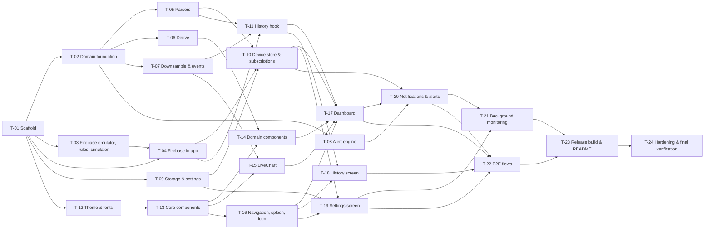

# Build Plan

Build in order. Do not start a task until its dependencies are done and verified. After each task, tick its Definition of Done and add an entry to [CHANGELOG.md](CHANGELOG.md). Every task follows the verify loop in [07-testing-strategy.md](07-testing-strategy.md#the-verify-loop).

**Standard Definition of Done** (included in every task below as "Standard DoD"):
- [ ] Behavior matches the referenced acceptance criteria
- [ ] Tests written for happy and unhappy paths and passing
- [ ] Full suite green (`npm test`), no regressions
- [ ] `npm run typecheck` and `npm run lint` clean
- [ ] `npm run build:android:debug` succeeds (from T-01 onward)
- [ ] Verified end to end at the real boundary (per the verify loop)
- [ ] `CHANGELOG.md` updated

## Dependency overview

---

## T-01 — Scaffold the project and tooling

- **Goal:** A React Native CLI TypeScript app named PowerGuardMonitor that builds a debug APK, with lint, typecheck and Jest wired up.
- **Depends on:** none
- **Skill(s) to use:** React Native Community CLI; npm. No Expo tooling. Read [ADR-0001](decisions/0001-react-native-cli.md).
- **Steps:**
  1. `npx @react-native-community/cli@latest init PowerGuardMonitor --package-name com.hexcodeplus.powerguard` (TypeScript template is the default). Confirm New Architecture and Hermes are enabled.
  2. Set app display name "PowerGuard Monitor" (`android/app/src/main/res/values/strings.xml`). Lock portrait orientation. Set `minSdkVersion 24`.
  3. `tsconfig.json`: `strict: true`, `noUncheckedIndexedAccess: true`, path alias `@/*` → `src/*` (with `babel-plugin-module-resolver`).
  4. ESLint (RN community config + `@typescript-eslint`) with `--max-warnings 0`; rules: no `any` in `src/types` and `src/domain`, no hex color literals outside `src/theme/tokens.ts` (`no-restricted-syntax` on `/^#[0-9a-f]{3,8}$/i` string literals), no `.skip`/`.only` in tests. Prettier.
  5. Jest config with `jest.setup.ts`, the coverage thresholds from [07](07-testing-strategy.md#coverage-gates), and transformIgnorePatterns for RN libraries.
  6. npm scripts: `test`, `test:coverage`, `typecheck`, `lint`, `build:android:debug`.
  7. Create the folder skeleton from [02-architecture.md → Repository layout](02-architecture.md#repository-layout).
  8. `.gitignore` additions from [06-security.md](06-security.md#secrets--config). `.env.example`.
  9. Record exact versions of RN, React and Node in `CHANGELOG.md`.
- **Tests to write:** `src/smoke.test.ts` asserting Jest + path alias work (`import { } from '@/...'`).
- **Definition of Done:** Standard DoD, plus the default app launches on an emulator via `npx react-native run-android`.

## T-02 — Domain foundation: types, constants, time, errors

- **Goal:** Shared types and constants every other module imports.
- **Depends on:** T-01
- **Skill(s) to use:** none needed (plain TypeScript).
- **Steps:**
  1. `src/types/models.ts` exactly as in [03-data-model.md → TypeScript models](03-data-model.md#typescript-models).
  2. `src/domain/constants.ts` with every value in [02-architecture.md → Constants](02-architecture.md#constants).
  3. `src/domain/time.ts`: `nowSeconds`, `setClock`, `resetClock`, `toSeconds` (re-exported by parsers).
  4. `src/domain/connectivity.ts`: `computeConnectivity` per [02 → Connectivity model](02-architecture.md#connectivity-model).
  5. `src/utils/errors.ts`: `AppError`, `AppErrorCode`. `src/utils/logger.ts`.
- **Tests to write:** `time.test.ts` (clock override, ms→s normalization at the 1e12 boundary); `connectivity.test.ts` (every row of the state diagram, boundaries at exactly 10 s and 15 s, `phoneConnected` null/false/true).
- **Definition of Done:** Standard DoD.

## T-03 — Firebase emulator config, rules, rules tests, simulator

- **Goal:** A local Firebase backend that can be filled with scenario data, and rules proven correct.
- **Depends on:** T-01
- **Skill(s) to use:** Firebase CLI (`firebase-tools`), `@firebase/rules-unit-testing`, `firebase-admin`, `tsx`.
- **Steps:**
  1. `firebase/firebase.json` with emulators: auth 9099, database 9000, UI 4000; `database.rules` → `database.rules.json`.
  2. `firebase/database.rules.json` exactly as in [06-security.md → RTDB rules](06-security.md#rtdb-rules).
  3. `tools/rules-tests/rules.test.ts` + its jest config; script `test:rules`.
  4. `tools/simulator/simulate.ts` per the CLI contract in [04-api-spec.md](04-api-spec.md#simulator-cli-contract); scenarios from [03-data-model.md](03-data-model.md#simulator-scenarios-toolssimulatorscenarios). Emulator mode targets namespace `demo-powerguard-default-rtdb`.
  5. Scripts: `emulators`, `sim`.
- **Tests to write:** rules tests: anonymous user can read live/status/history; anonymous user **cannot** write live/status/history; unauthenticated cannot read; ESP32 uid (seeded in `/config/writers`) can write valid live; ESP32 write with an extra field or a non-boolean `smoke` fails; nobody can read `/config`. Simulator: `simulate.test.ts` for flag parsing and the `--target project` without `--yes` refusal.
- **Definition of Done:** Standard DoD, plus `npm run emulators` then `npm run sim -- --scenario smoke` shows data changing in the emulator UI at `localhost:4000`.

## T-04 — Firebase integration in the app

- **Goal:** The app signs in anonymously and can read RTDB, against a real project or the emulator.
- **Depends on:** T-01, T-03
- **Skill(s) to use:** `@react-native-firebase/app`, `/auth`, `/database` (follow their current Android install docs), `react-native-config`. Read [ADR-0003](decisions/0003-react-native-firebase.md).
- **Steps:**
  1. Install packages; apply the `com.google.gms.google-services` Gradle plugin; add `android/app/google-services.demo.json` (placeholder values, project `demo-powerguard`).
  2. Install `react-native-config`; `src/config/appConfig.ts` exposing typed keys from [09 → Configuration](09-deployment-ops.md#configuration). Force `useEmulator = false` when `!__DEV__ && !Config.E2E`.
  3. `src/services/firebase.ts` per the `FirebaseService` interface: configure `database(url?)`, `setPersistenceEnabled(true)` before first use, `useEmulator` for auth and database when enabled, `ensureSignedIn()`.
  4. Debug-only network security config allowing cleartext to `10.0.2.2` and `localhost`.
  5. Firebase Jest mock per [07 → Firebase mock contract](07-testing-strategy.md#firebase-mock-contract-srctestmocksfirebasets).
- **Tests to write:** `firebase.test.ts`: reuses `currentUser`; signs in when absent; maps failure to `AppError('auth_failed')`; calls `useEmulator` only when configured; persistence enabled before any `ref()`.
- **Definition of Done:** Standard DoD, plus a temporary debug screen (removed in T-17) shows the uid and the raw `/live` JSON from the emulator while the simulator runs.

## T-05 — Parsers

- **Goal:** Untrusted RTDB values become typed models without ever throwing.
- **Depends on:** T-02
- **Skill(s) to use:** none needed.
- **Steps:** Implement `src/domain/parsers.ts` per [04-api-spec.md → Parsing rules](04-api-spec.md#parsing-rules). Add fixtures and factories from [03 → Unit test fixtures](03-data-model.md#unit-test-fixtures-srctestfixtures).
- **Tests to write:** `parsers.test.ts`: every row of the parsing-rules table; every entry in `malformedRaws` (no throw, correct fallback, correct `invalid` flags); last-valid carry-over; ms timestamps; history sorting and dropping samples without `ts`.
- **Definition of Done:** Standard DoD (FR-12).

## T-06 — Derived values

- **Goal:** Power, threshold levels, worst state, active alerts, labels.
- **Depends on:** T-02
- **Skill(s) to use:** none needed.
- **Steps:** Implement `src/domain/derive.ts` per [04 → Domain interfaces](04-api-spec.md#domain-srcdomain) and [FR-3](01-requirements.md#fr-3-threshold-evaluation)/[FR-4](01-requirements.md#fr-4-hero-status-banner).
- **Tests to write:** `derive.test.ts`: all boundary cases in [07](07-testing-strategy.md#must-have-boundary-cases-derivetestts); worst-state priority for every pair; `faultTypeLabel` for every type including `unknown`; `rssiBars` boundaries; `power` rounding.
- **Definition of Done:** Standard DoD (FR-3, FR-4 logic).

## T-07 — Downsampling and event extraction

- **Goal:** Chart series fit point caps; history becomes a list of transitions.
- **Depends on:** T-02
- **Skill(s) to use:** none needed.
- **Steps:** `downsample.ts` (LTTB: keeps first/last, preserves order, returns input when under cap); `events.ts` (`extractEvents`, `groupEventsByDay` with "Today"/"Yesterday"/"Mon, 12 Oct").
- **Tests to write:** `downsample.test.ts` (under cap → identical; 8,640 → exactly 150; first/last kept; spike preserved); `events.test.ts` (started/cleared per key, first sample already true → no start event, fault type on start, newest first, day grouping across midnight using `setClock`).
- **Definition of Done:** Standard DoD (FR-5, FR-6 logic).

## T-08 — Alert engine

- **Goal:** The pure alert reducer, exhaustively tested.
- **Depends on:** T-02
- **Skill(s) to use:** none needed.
- **Steps:** Implement `src/domain/alertEngine.ts` per [02 → Alert engine](02-architecture.md#alert-engine).
- **Tests to write:** `alertEngine.test.ts`: all 10 must-have cases in [07](07-testing-strategy.md#must-have-alert-engine-cases-alertenginetestts), plus a table-driven test running each simulator scenario's live sequence through the reducer and asserting the exact effect list.
- **Definition of Done:** Standard DoD (FR-7 logic). Domain coverage gate met.

## T-09 — Storage service and settings store

- **Goal:** Settings persist, validate and hydrate safely.
- **Depends on:** T-01
- **Skill(s) to use:** `@react-native-async-storage/async-storage`, Zustand `persist` middleware. Read [ADR-0004](decisions/0004-zustand-state.md).
- **Steps:** `src/services/storage.ts` per interface; `validateSettings` in `src/domain/settings.ts`; `src/store/settingsStore.ts` with actions `setDeviceId`, `setAlert(key, bool)`, `setThresholds(partial)`, `resetThresholds()`, `setBackgroundMonitoring(bool)`, `setTheme(pref)`; persist key `pg:settings:v1`; `hydrated` flag.
- **Tests to write:** `settings.test.ts` (each validation rule, merge over defaults, garbage input); `settingsStore.test.ts` (persist round-trip, corrupt JSON → defaults, threshold invariants enforced in `setThresholds`).
- **Definition of Done:** Standard DoD (FR-8 logic).

## T-10 — Device store, subscriptions and connectivity

- **Goal:** Live data and connectivity flow from RTDB into a selector-friendly store, with device switching.
- **Depends on:** T-04, T-05, T-09
- **Skill(s) to use:** Zustand; RNTL for hook tests with fake timers.
- **Steps:** `src/store/deviceStore.ts` per [03 → deviceStore state](03-data-model.md#devicestore-state); `src/core/subscriptionManager.ts`; `src/core/bootstrap.ts` (idempotent; hydrate → sign in → subscribe; alert controller and background hooks added in T-20/T-21); hooks `useLive`, `useConnectivity` (1 s ticker), `useWorstState`.
- **Tests to write:** `deviceStore.test.ts` (setters, reset, `switchDevice` removes old listeners via `__listenerCount` and attaches new ones); `subscriptionManager.test.ts` (emit live/status/.info → store; permission error → `error`); `useConnectivity.test.ts` (loading → device_offline at 10 s; online → offline at 15 s; phone_offline priority); `deviceStore.render.test.tsx` (NFR-3 render counts); `bootstrap.test.ts` (idempotent, auth failure path).
- **Definition of Done:** Standard DoD (FR-1, FR-2, FR-9 logic), plus with the emulator + `healthy` scenario, the temporary debug screen shows connectivity `online`, and stopping the simulator shows `device_offline` within 16 s.

## T-11 — History hook

- **Goal:** Range queries and live append for the chart and History screen.
- **Depends on:** T-04, T-05, T-07
- **Skill(s) to use:** `@react-native-firebase/database` queries.
- **Steps:** `src/hooks/useHistory.ts` per [04 → QUERY history](04-api-spec.md#query-devicesdeviceidhistory--history-range), including ms-unit detection and 5 m live append with key dedupe. Re-query on device change.
- **Tests to write:** `useHistory.test.ts`: correct `startAt` per range; success/empty/error states and `refetch`; ms detection re-query; `child_added` append and dedupe; listener removed on unmount and device change.
- **Definition of Done:** Standard DoD.

## T-12 — Theme system and fonts

- **Goal:** Tokens, typography, theme resolution and bundled fonts.
- **Depends on:** T-01
- **Skill(s) to use:** If available, the `frontend-design` skill for visual judgment. `react-native.config.js` asset linking (`npx react-native-asset`).
- **Steps:** `tokens.ts` (both themes exactly per [05 → Design tokens](05-ui-ux.md#design-tokens)); `typography.ts`; `ThemeProvider.tsx` (system/dark/light from settings, live OS changes, system bar colors via `StatusBar` + `react-native-edge-to-edge` or the RN built-in edge-to-edge for the RN version in use); `strings.ts`; download Inter and JetBrains Mono (OFL) into `assets/fonts/`; link them.
- **Tests to write:** `tokens.contrast.test.ts` (every text token × {background, surface} × both themes ≥ 4.5:1); `ThemeProvider.test.tsx` (preference resolution and OS change).
- **Definition of Done:** Standard DoD (FR-11), plus a screenshot of a sample text screen shows both fonts rendering on device.

## T-13 — Core components

- **Goal:** The base component kit.
- **Depends on:** T-12
- **Skill(s) to use:** `react-native-reanimated`, `react-native-gesture-handler`, `react-native-svg`, `react-native-linear-gradient`, `lucide-react-native`. Configure the Reanimated Babel plugin **last** in `babel.config.js`.
- **Steps:** Build `Card`, `AppText`, `Icon`, `Pill`, `Skeleton`, `EmptyState`, `ErrorState`, `Switch`, `Slider`, `SegmentedControl` per [05 → Component inventory](05-ui-ux.md#core-srccomponentscore); `useReducedMotion` hook.
- **Tests to write:** one test file per component covering props → output, accessibility labels/roles, and the reduce-motion static path for `Skeleton`.
- **Definition of Done:** Standard DoD.

## T-14 — Domain components

- **Goal:** `HeroStatusBanner`, `ArcGauge`, `PowerChip`, `StatusTile`, `ConnectionPill`, `EventRow`, `PermissionCard`.
- **Depends on:** T-13, T-06
- **Skill(s) to use:** `react-native-svg` + Reanimated (`useAnimatedProps` for arc sweep). `frontend-design` skill if available.
- **Steps:** Build each per [05 → Domain components](05-ui-ux.md#domain-srccomponentsdomain) and [Motion](05-ui-ux.md#motion). Wrap each in `React.memo`.
- **Tests to write:** per-component tests for every state (ok/warning/danger, active/inactive, stale, invalid, each connectivity value, each worst state); accessibility value strings; reduce-motion disables loops.
- **Definition of Done:** Standard DoD (FR-2/3/4 visuals).

## T-15 — LiveChart

- **Goal:** Dual-series SVG chart with ranges and tooltip.
- **Depends on:** T-13, T-07
- **Skill(s) to use:** `react-native-svg`, gesture handler. Read [ADR-0006](decisions/0006-custom-svg-charts.md).
- **Steps:** Path building (monotone cubic), dual Y scales with padded min/max, gradient fills, 4 grid lines, time labels, pan-to-inspect tooltip, empty/error/loading states.
- **Tests to write:** `LiveChart.test.tsx` (renders paths for valid data, empty state under 2 points, error state Retry calls `onRetry`); `chartScale.test.ts` for pure scale helpers.
- **Definition of Done:** Standard DoD (FR-5 visuals).

## T-16 — Navigation, tab bar, splash and icon

- **Goal:** App shell with three tabs, splash and launcher icon.
- **Depends on:** T-13
- **Skill(s) to use:** React Navigation (native-stack, bottom-tabs), `react-native-screens`, `react-native-safe-area-context`; Android Studio vector asset conventions for the adaptive icon.
- **Steps:** `RootNavigator`, custom `TabBar` per [05 → Navigation](05-ui-ux.md#navigation); placeholder screens; `ErrorBoundary`; adaptive icon + monochrome layer + Android 12 splash per [05 → App icon and splash](05-ui-ux.md#app-icon-and-splash).
- **Tests to write:** `TabBar.test.tsx` (switching tabs, accessibility roles/labels); `ErrorBoundary.test.tsx`.
- **Definition of Done:** Standard DoD, plus the icon and splash render correctly on an Android 12+ emulator and an Android 8 emulator.

## T-17 — Dashboard screen

- **Goal:** The full dashboard wired to live data.
- **Depends on:** T-10, T-11, T-14, T-15, T-16
- **Skill(s) to use:** none beyond the above.
- **Steps:** Compose per [05 → Dashboard](05-ui-ux.md#dashboard), including every state in its table, pull-to-refresh and bootstrap retry. Remove the temporary debug screen.
- **Tests to write:** `DashboardScreen.test.tsx`: loading skeletons; healthy render with formatted values (FR-1 examples); live update changes text; liveEmpty; device_offline muted state; phone_offline text; auth_failed and permission_denied error states with Retry.
- **Definition of Done:** Standard DoD (FR-1, FR-2, FR-4, FR-13), plus every simulator scenario was played against the emulator and the dashboard matched the acceptance criteria.

## T-18 — History screen

- **Goal:** Day-grouped, filterable event list.
- **Depends on:** T-11, T-16
- **Skill(s) to use:** none beyond the above.
- **Steps:** Per [05 → History](05-ui-ux.md#history) using `useHistory('events')`, `extractEvents` and `groupEventsByDay`.
- **Tests to write:** `HistoryScreen.test.tsx`: grouped render, filter chips, empty, error + Retry, fault type shown.
- **Definition of Done:** Standard DoD (FR-6), plus verified with the `history-24h` scenario.

## T-19 — Settings screen

- **Goal:** All settings editable and persisted, with device switching.
- **Depends on:** T-09, T-10, T-16
- **Skill(s) to use:** none beyond the above.
- **Steps:** Per [05 → Settings](05-ui-ux.md#settings). Saving the device ID calls `switchDevice`. The background toggle is present but wired in T-21 (until then it only persists the value).
- **Tests to write:** `SettingsScreen.test.tsx`: device ID validation and Save enablement; switch toggles persist; slider invariants; reset to defaults; theme change applies.
- **Definition of Done:** Standard DoD (FR-8, FR-9, FR-11).

## T-20 — Notifications, alert controller and haptics

- **Goal:** Real notifications and haptics on alert rising edges.
- **Depends on:** T-08, T-10, T-17
- **Skill(s) to use:** `@notifee/react-native` (Android channels, permission), `react-native-haptic-feedback`. Read [ADR-0005](decisions/0005-local-notifications-foreground-service.md).
- **Steps:** `notificationService` (channels per [02](02-architecture.md#alert-engine), fixed ids, tap → Dashboard); `hapticService`; `alertController` per [02 → Live update and alert](02-architecture.md#live-update-and-alert) with per-device persisted state; add to `bootstrap`; permission request timing and `PermissionCard` per [FR-14](01-requirements.md#fr-14-notification-permission).
- **Tests to write:** `alertWiring.test.ts` (Firebase mock emits smoke ×2 → `displayAlert('smoke')` once and `haptic.alert` once; status-only updates don't count; restart with persisted state → no notify; device switch loads the other device's state); `notifications.test.ts` (channels created once, ids fixed, permission flow incl. the once-only prompt).
- **Definition of Done:** Standard DoD (FR-7, FR-14), plus manual check M-2 passes on an Android 13+ emulator.

## T-21 — Background monitoring

- **Goal:** Optional foreground service keeps alerts working while minimized.
- **Depends on:** T-20, T-19
- **Skill(s) to use:** Notifee foreground service API; Android foreground-service type docs for the current targetSdk.
- **Steps:** `backgroundService` per interface; `registerForegroundTask` and `registerBackgroundEvents` in `index.js` before `AppRegistry.registerComponent`; manifest service declaration with the foreground service type from [ADR-0005](decisions/0005-local-notifications-foreground-service.md) and its permissions; persistent notification text follows `useWorstState` logic (computed outside React from the stores); Stop action → stop + `setBackgroundMonitoring(false)`; start on bootstrap when enabled; Battery optimization row.
- **Tests to write:** `background.test.ts` (start requests permission, denied → returns `permission_denied` and toggle reverts; stop clears; update text on worst-state change; Stop action handler).
- **Definition of Done:** Standard DoD (FR-10), plus manual check M-3 passes.

## T-22 — E2E flows

- **Goal:** Six Maestro flows green against the emulator stack.
- **Depends on:** T-17, T-18, T-19, T-20
- **Skill(s) to use:** Maestro CLI. Read [ADR-0009](decisions/0009-testing-maestro-firebase-emulator.md).
- **Steps:** `.env.e2e`, `android:e2e` and `e2e` scripts; `.maestro/scripts/rtdb.js`; flows 01–06 per [07 → E2E flows](07-testing-strategy.md#e2e-flows). Add `testID`s where text matching is brittle.
- **Tests to write:** the six flows themselves.
- **Definition of Done:** Standard DoD, plus `npm run e2e` passes 3 times in a row (no flakiness).

## T-23 — Release build and README

- **Goal:** A signed, minified release APK/AAB and complete setup docs.
- **Depends on:** T-21, T-22
- **Skill(s) to use:** Gradle signing configs; R8/ProGuard.
- **Steps:** Signing config reading `PG_UPLOAD_*` from Gradle properties/env; `minifyEnabled true` + keep rules required by Firebase, Notifee and Reanimated (per their docs); ABI splits for APK; `build:android:release` and `bundle:android` scripts; `README.md` covering prerequisites, Firebase setup, running, simulator, tests, building (mirror [09](09-deployment-ops.md)).
- **Tests to write:** none new; run the full gate on a release build and the M-1 smoke check with the release APK.
- **Definition of Done:** Standard DoD, plus release APK installs and passes M-1; arm64 APK size ≤ 30 MB (NFR-11).

## T-24 — Hardening and final verification

- **Goal:** Confirm every requirement on real hardware and close gaps.
- **Depends on:** T-23
- **Skill(s) to use:** Android Studio profiler / `dumpsys gfxinfo`; TalkBack.
- **Steps:** Run manual checks M-1 to M-5; fix issues found (each fix gets a regression test); walk the traceability table in [01](01-requirements.md#traceability) and confirm each FR has a passing test; resolve or explicitly defer every `[TODO]`.
- **Tests to write:** regression tests for any bug found.
- **Definition of Done:** Standard DoD, plus the global Definition of Done in [AGENTS.md](AGENTS.md#7-definition-of-done-global) is met.
